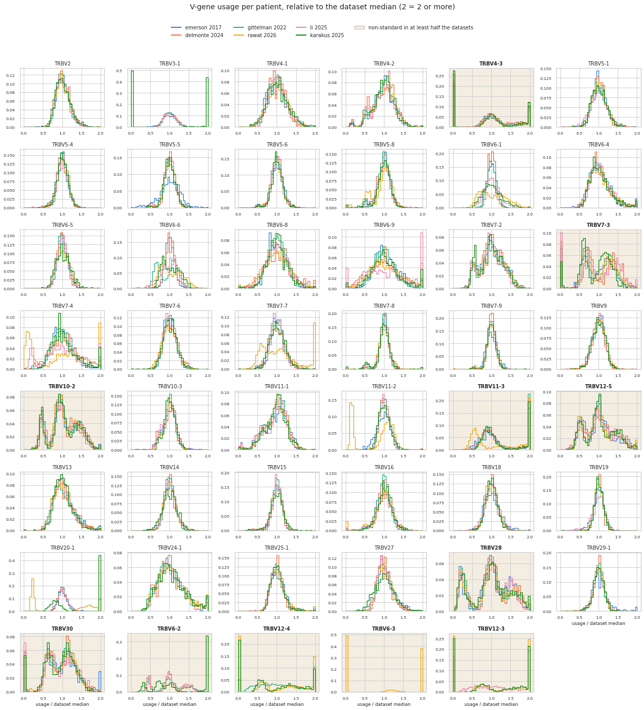

# Germline variation in V-gene usage

Some V genes vary in usage between people for germline reasons: a gene deleted from one or both
chromosomes, or an allele that is used more or less. That variation isn't technical, yet in a merged
dataset it can still line up with a batch or a label (e.g. through ancestry). vAIRRify marks these genes
in the PCA plot (`vf.features.GERMLINE_V_GENES`):

**TRBV4-3, TRBV6-2/6-3, TRBV7-2, TRBV7-3, TRBV28, TRBV30**

The analysis below also flags **TRBV10-2, TRBV11-3 and TRBV12-5** as candidates. TODO: decide whether
to add them.

## The literature: Omer et al. 2022

Omer A., Peres A., ..., Yaari G. *T cell receptor beta germline variability is revealed by inference
from repertoire data.* Genome Medicine 14:2 (2022). doi:10.1186/s13073-021-01008-4

- **A common ~21-kb deletion** removes TRBV4-3, the pseudogene TRBV3-2 and one of the identical pair
  TRBV6-2/6-3. In their data, TRBV4-3 was absent from the expressed repertoire of 8 of 28 and 8 of 25
  people.
- **The TRBV7-2\*02 allele marks that deletion.** All 40 long-read haplotypes carrying it had the
  deletion, as did 8 of the 27 carrying \*01. TRBV6-2/6-3 usage in people with two copies of \*02 was
  less than half that in people with two copies of \*01.
- **Rarer deletions of single genes**: TRBV11-1, TRBV7-3, TRBV30 (also a pseudogene allele with an
  in-frame stop codon), TRBV2, TRBV4-2, TRBV6-5, TRBV5-5, TRBV13 and TRBV28 (on one chromosome, 4 samples)
- **Haplotypes**: TRBV28\*Del and TRBV24-1\*02 were both seen on the chromosome carrying TRBJ1-6\*02
- **Some genes can't be told apart** with every protocol: TRBV6-2/6-3 at full length; with Adaptive
  reads also TRBV12-3/12-4, TRBV3-1/3-2 and TRBV6-5/6-6

## The evidence: all V genes in six cohorts

Which genes actually have non-standard usage? For every V gene we compared each patient's usage to the
dataset median, in one repertoire per patient with at least 20,000 clonotypes.

| Dataset | Patients | Protocol |
|---|---|---|
| Emerson et al. 2017 | 782 | Adaptive |
| DelMonte et al. 2024 | 495 | Adaptive |
| Gittelman et al. 2022 | 2,589 | Adaptive |
| Rawat et al. 2026 | 2,072 | Adaptive (via iReceptor) |
| Li et al. 2025 | 1,040 | TODO: confirm |
| Karakus et al. 2025 | 800 | TODO: confirm (via iReceptor) |

A gene is **non-standard** in a dataset when:

- at least 2% of patients lack it (below 0.05× the median, as a deletion on both chromosomes would give), or
- its usage has at least two modes, each holding 3% of patients: peaks of a smoothed density of
  log2(usage / median), with a prominence of at least 15% of the highest peak

It is highlighted when non-standard in at least half the datasets that assign it.



### What the highlighted genes are

| Gene | Non-standard in | Pattern | Reading |
|---|---|---|---|
| **TRBV4-3** | 6 of 6 | absent in 21–27% | the 21-kb deletion on both chromosomes |
| **TRBV7-3** | 6 of 6 | absent in 5–10%; two further groups | a deletion polymorphism (both chromosomes, one, neither) |
| **TRBV30** | 6 of 6 | absent in 5–7% | a deletion, or the pseudogene allele |
| **TRBV28** | 4 of 6 | a low group at ~0.1–0.2×, never absent | more like a common low-usage allele than a deletion |
| **TRBV6-2/6-3** | 4 of 4 assigning it | two or three groups | one gene copy fewer: 0.43–0.46× where TRBV4-3 is absent (karakus 0.74×) |
| **TRBV10-2** | 6 of 6 | two modes at ~0.5× and 1×, and a shoulder at ~1.4× | **new**: 1.31–1.40× higher where TRBV4-3 is absent, so tied to the deletion haplotype. Not in Omer et al. |
| **TRBV11-3** | 6 of 6 | a high group at 2× or more | **new**, unexplained; not tied to TRBV4-3 (~1× where it's absent) |
| **TRBV12-5** | 3 of 6 | groups around 0.5×, 1× and 1.5× | **new**, weaker; not tied to TRBV4-3 |
| TRBV12-3, TRBV12-4, TRBV6-3 | 3 of 3, 3 of 3, 1 of 1 | 5–49% of patients at zero | gene assignment: these pairs can't be told apart, and only some exports assign them |

### Checks on the new genes

- **Not a swap with a similar gene.** If an allele were assigned to a neighbouring gene, the two would
  trade usage. Instead they barely correlate: TRBV10-2 with TRBV10-3 ρ = +0.09 to +0.16, TRBV11-3 with
  TRBV11-2 +0.02 to +0.32, TRBV12-5 with TRBV12-4 +0.13 to +0.17. The exception is rawat, where TRBV11-3
  and TRBV11-2 do trade (ρ = −0.64): an annotation effect in that export.
- **Linked to the deletion haplotype**: TRBV10-2 rises (1.31–1.40×) and TRBV7-2 falls (0.56–0.60×) where
  TRBV4-3 is absent. TRBV11-3 and TRBV12-5 don't move.
- **TRBV28 and TRBV24-1** usage correlates (ρ = +0.21 to +0.38), consistent with Omer et al. seeing
  TRBV28\*Del and TRBV24-1\*02 on the same chromosome. TODO: check at haplotype level.

### Not highlighted, but worth knowing

- **TRBV7-2** has a single mode, so the criterion doesn't flag it, yet its usage is 0.56–0.60× in
  people without TRBV4-3. It stays in `GERMLINE_V_GENES` for that link.
- **Quirks of single datasets** (gene assignment in those exports): in karakus, TRBV3-1 is absent in
  half of the patients and TRBV20-1 piles up at 2× or more; in rawat, TRBV11-2, TRBV20-1 and TRBV7-4
  have spikes far from the median

### Cross-check outside Adaptive

The zaslavsky data (Mal-ID, not Adaptive) show the same signals: TRBV7-3 absent in 22 and TRBV30 in 15
of 542 repertoires, TRBV28 reduced (5–35% of the median) in 76, and TRBV6-2 usage 0.56× in repertoires
without TRBV4-3. TRBV4-3 absence there varies strongly between batches (0–30%), so part of it may be
gene assignment rather than germline.

## Caveats

- Most cohorts are Adaptive, so platform-specific gene assignment could contribute; the zaslavsky
  cross-check suggests the main patterns hold elsewhere. Simnica et al. 2019 (BIOMED-2) was left out:
  its libraries (median ~4,000 clonotypes) are too shallow for single-gene usage.
- The criterion flags any non-standard distribution, including gene assignment; the readings above
  separate the two
- The cut-offs and the density smoothing describe the distributions; they don't genotype individuals
- TRBV3-2, the pseudogene in the 21-kb deletion, isn't counted: tcrio keeps functional genes only

## Reproduce

```bash
python docs/scripts/germline_v_genes.py /data/current/tcrio_db docs/docs/img/germline_v_genes.png
```

The script reads existing tcrio results (`GeneCountsSummary`, version 0.4 or later) and doesn't
recompute or write to the datasets. It saves the per-dataset results next to the figure
(`germline_v_genes.tsv`) and prints the linkage and neighbour checks.
